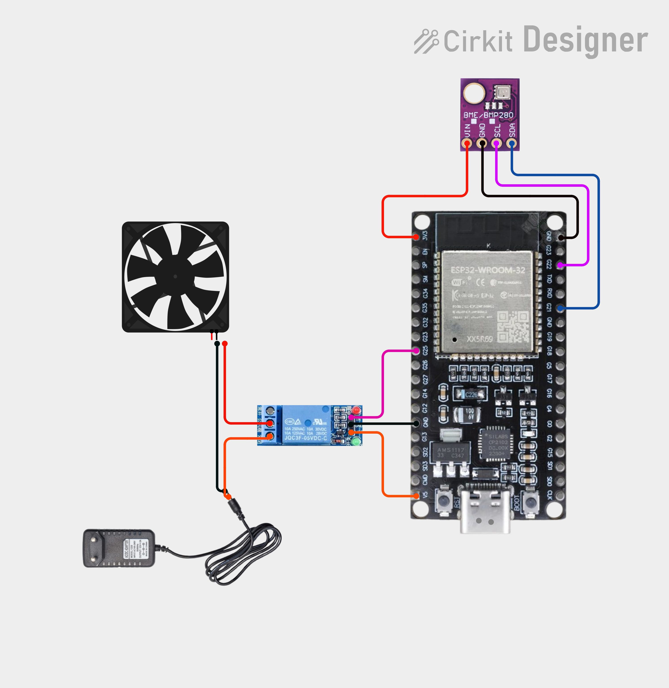

## 1. Required Hardware

| Part | Notes |
|---|---|
| ESP32 dev board | Any 30/38-pin module |
| BME280 module | I2C, address `0x76` or `0x77` (auto-detected) |
| Relay module | Optional, 3.3V-compatible signal |

## 2. Wiring

| Signal | ESP32 Pin | Connect to |
|---|---|---|
| I2C SDA | GPIO 21 | BME280 SDA |
| I2C SCL | GPIO 22 | BME280 SCL |
| Relay IN | GPIO 25 | Relay module IN |
| Status LED | GPIO 2 | Built-in LED (onboard) |
| Factory reset | GPIO 0 | BOOT button (built-in) |
| 3.3V / GND | 3V3 / GND | BME280 VCC/GND, Relay VCC/GND |

> ⚠️ **Power the relay module from a separate 5V supply if it has a coil** — ESP32 3.3V cannot drive relay coils directly. Use a relay module with built-in opto-isolation and transistor driver.

## 3. Flash the Firmware

**Arduino IDE:**
1. Install **ESP32 board package** (Boards Manager → "esp32 by Espressif").
2. Install libraries via Library Manager:
   - `Adafruit BME280 Library`
   - `Adafruit Unified Sensor`
3. Board: **ESP32 Dev Module**. Upload speed: **921600**.
4. Select correct COM port → **Upload**.
5. Or download the firmware above and flash

## 4. First Boot — Connect

1. Power on. Wait ~5 seconds.
2. On your phone/laptop, connect to WiFi:
   - **SSID:** `ESP32-BME280`
   - **Password:** `12345678`
3. A captive portal should pop up automatically. If not, open browser → **http://192.168.4.1**
4. Login: **Username `admin`**, **Password `12345678`**

## 5. Configure (in order)

### A. Change admin password — **do this first**
System tab → **Change Admin Password** → enter 8–32 chars → **Change Password** → reload page → log in with new password.

### B. Configure WiFi STA (optional — for home network access)
WiFi STA tab:
- **SSID / Password** — your home WiFi
- **Mode:** DHCP (recommended) or Static
- If Static: fill IP, Gateway, Subnet mask (e.g. `255.255.255.0`), DNS1
- **Hostname** — e.g. `bme280` (reachable as `bme280.local`)
- Click **Apply STA** → banner appears → click **Reboot Now**

### C. Set thresholds & relay
Thresholds tab:
- **Alerts:** Enabled
- **Temp min/max, Humidity min/max, Pressure min/max** — your safe ranges
- **Save Thresholds**

Relay section (below thresholds):
- **Relay enabled:** Yes
- **Logic:** OR (turn on if any alert) or AND (only if all alerts)
- **React to temperature/humidity/pressure:** pick metrics
- **Active-low relay:** Yes if your relay module is active-low (most are)
- **Save Relay Settings**

### D. WiFi AP settings (optional)
WiFi AP tab — change SSID, password, channel, TX power. Click **Apply AP** (takes effect immediately, no reboot).

## 6. Daily Use

- Open **http://192.168.4.1** (AP mode) or **http://<sta-ip>** / **http://bme280.local** (STA mode).
- **Dashboard** auto-refreshes every 2s: temperature, humidity, pressure, sensor status, relay status.
- Out-of-range values highlight **yellow**; sensor failure shows **red**.
- Relay state shown as **ON/OFF (GPIO 25)**.

## 7. Maintenance

| Task | How |
|---|---|
| **Reboot** | System tab → Reboot |
| **Factory reset** | Hold **BOOT button 5s**, or System tab → Factory Reset (type `RESET`) |
| **Change admin password** | System tab |
| **Change thresholds / relay** | Thresholds tab |
| **Check uptime / heap** | System tab (uptime resets at ~49.7 days — cosmetic) |

## 8. Status Indicators

**Dashboard sensor status:**
- 🟢 **Sensor OK at 0x76** — all good
- 🟡 **Sensor partial** — one metric unavailable; relay skips that metric
- 🔴 **Sensor not detected** — auto-retries every 10s, I2C bus recovery every 3rd attempt

**LED (GPIO 2):** blinks 1 Hz = running normally.

## 9. Troubleshooting

| Symptom | Fix |
|---|---|
| Can't connect to `ESP32-BME280` | Wait 10s after power-on; check 3.3V supply |
| Captive portal doesn't pop up | Manually open `http://192.168.4.1` |
| Sensor not detected | Check SDA=21, SCL=22, 3.3V, GND; try address `0x77` (auto-detected) |
| Relay always ON/OFF | Toggle **Active-low relay** setting |
| STA won't connect | Verify SSID/password; check 2.4GHz (ESP32 does not support 5GHz) |
| Forgot admin password | Factory reset (hold BOOT 5s), password returns to `12345678` |
| Wrong static IP after save | Reboot; if unreachable, factory reset and reconfigure |

## 10. Safety Notes

- Relay **fails OFF** on sensor loss (both OR and AND logic) — safe for most uses.
- **Do not** switch mains voltage directly through the relay module unless it is rated for it and properly enclosed.
- Use a **separate 5V supply** for relay coils, common ground with ESP32.
- The device runs unattended for years — ensure adequate ventilation and a stable 5V supply.

## 11. Default Credentials (after factory reset)

| Setting | Value |
|---|---|
| AP SSID | `ESP32-BME280` |
| AP Password | `12345678` |
| Web login | `admin` / `12345678` |
| AP IP | `192.168.4.1` |

**Change the admin password on first use** — the default is publicly known.

### Reboot the ESP32
**System** tab → **Reboot** button.

### Factory reset (erase everything)
Two ways:
- **System** tab → **Factory Reset** → type `RESET` → confirm.
- Or hold the **BOOT button** on the ESP32 for **5 seconds**.

After factory reset, the ESP32 returns to `ESP32-BME280` / `12345678` and admin `admin` / `12345678`.

---

## 9. Quick troubleshooting

| Problem | Fix |
|---|---|
| Can't see `ESP32-BME280` WiFi | Wait 30 s after power on, or check USB power is enough |
| Web page doesn't load | Try `http://192.168.4.1` directly. Make sure you're connected to the ESP32's WiFi |
| Dashboard shows "Sensor not detected" | Check BME280 wiring: SDA→21, SCL→22, VCC→3V3, GND→GND |
| Relay clicks ON at boot then OFF | Normal — add the 10 kΩ pull-down resistor (step 2) |
| Relay never turns ON | Check **Relay enabled = Yes**, at least one metric selected, and the invert setting matches your module |
| Relay ON when value looks OK | You have the invert setting wrong — try the opposite |
| Relay flickering at threshold | Increase the gap between min and max thresholds slightly |
| Forgot admin password | Factory reset (step 8), then log in with default `admin` / `12345678` |

---

## 10. Safety note

GPIO 25 is **3.3 V logic**. If your relay module expects 5 V on the IN pin, confirm it accepts 3.3 V — most modules with an opto-isolator do. If yours does not, add a level shifter.

**Never** connect the relay coil directly to GPIO 25. Use a relay **module** (which has a transistor driver), never a bare relay coil.
